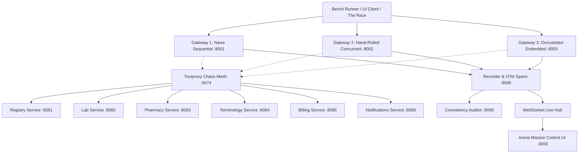

# Orcrustrator Arena: End-to-End Production Benchmark & Resilience Testbed

[](https://orcrustrator-arena.onrender.com)
[](#license)
[](#quick-start)
[](#tech-stack)
[](#cloud-deployment)
[](https://render.com/deploy?repo=https://github.com/PrinceBadru/orcrustrator-arena)

> 🌐 **Live Cloud Deployment**: [https://orcrustrator-arena.onrender.com](https://orcrustrator-arena.onrender.com)
>
> **"The same request, run through three implementations side by side, while you break the system live and watch what survives."**

Orcrustrator Arena is an empirical production testbed demonstrating how [Orcrustrator](https://github.com/BenziDarwin/Orcrustrator) behaves in realistic microservice topologies under live chaos, jitter, and network partitions. Built to run on a single Windows laptop with Docker Desktop (WSL2 backend) or deploy instantly to free container clouds.

---

## 🚀 Free 1-Click Cloud Deployment (Continuous Delivery)

On every `git push` to `master`, GitHub Actions automatically builds the multi-stage production container and publishes it to **GitHub Container Registry (GHCR)**:
```
ghcr.io/princebadru/orcrustrator-arena:latest
```

Because our Rust microservices and Axum gateways are compiled to lean native binaries, **the entire arena (UI + 6 Microservices + 3 Gateways + Auditor + Recorder) consumes only ~65MB RAM**, fitting completely within generous 100% free cloud tiers:

| Free Hosting Provider | Free Resources | Deployment Method | Auto-Deploy on Git Push |
| :--- | :--- | :--- | :--- |
| **[Render](https://render.com)** (Recommended) | **512MB RAM, 0.1 CPU**, Free TLS, Global CDN | 1-Click Button or Blueprint (`render.yaml`) | Yes (Instant rolling update) |
| **[Hugging Face Spaces](https://huggingface.co/spaces)** (Most Generous) | **16,000MB (16GB) RAM, 2 vCPU** (100% Free Forever) | Create Docker Space & import repo | Yes |
| **[Fly.io](https://fly.io)** | **256MB RAM VMs**, Free allowance | `fly launch` (`fly.toml`) | Yes (via flyctl) |
| **[Railway](https://railway.app)** | **$5 Trial Credit**, Instant container build | Import GitHub repo | Yes |

### Deploying to Koyeb in 60 Seconds (Free):
1. Create a free account at [koyeb.com](https://www.koyeb.com).
2. Click **Create App** &rarr; Select **GitHub** &rarr; Choose `PrinceBadru/orcrustrator-arena`.
3. Koyeb will automatically detect `Dockerfile` and `koyeb.yaml`, bind the public port to `$PORT`, and assign a free global HTTPS URL (e.g. `https://orcrustrator-arena-yourname.koyeb.app`).
4. Every time you push changes to GitHub, Koyeb automatically rebuilds and redeploys without downtime!

---

## 1. Architecture Overview



### The Three Implementations Competing Side-by-Side:
1. **Naive Gateway (Port 8001)**: Strictly sequential HTTP round-trips (`Registry` &rarr; `Labs` &rarr; `Pharmacy` &rarr; `Terminology` &rarr; `Billing`). Fire-and-forget naive rollback on write failures.
2. **Hand-Rolled Gateway (Port 8002)**: Direct `tokio::join!` for root/joins, fan-out concept resolution via `join_all`, bounded concurrency, exponential backoff retries, and explicit multi-stage compensation.
3. **Orcrustrator Gateway (Port 8003)**: Thin Axum wrapper embedding Orcrustrator's library with `MemoryCache`, `ChannelTransport` for CloudEvents, and declarative relation DAGs.

---

## 2. Realistic Clinical Scenarios (Uganda MoH Synthetic Data)

- **Read Scenario (`GET /patients/{id}/summary`)**:
  - Pulls patient demographic registry.
  - Concurrently fetches lab results, active prescriptions, and billing status.
  - Fans out terminology concept lookups for every coded lab (`LOINC`) and medication (`RxNorm`).
  - Warm cache hit resolves in microseconds directly from zero-allocation RAM.
- **Write Scenario (`POST /visits`)**:
  - Step 1: Creates Encounter in Registry.
  - Step 2: Reserves Stock in Pharmacy.
  - Step 3: Generates Invoice in Billing.
  - Step 4: Dispatches Notification.
  - If Step 3 or 4 fails, earlier steps must be undone (Saga pattern).

---

## 3. The "Breathtaking" Layer (Mission Control UI)

1. **The Race**: Single-click firing of requests across all 3 gateways simultaneously, rendering 60 FPS real-time side-by-side waterfall lanes.
2. **Live Service Map**: HTML5 Canvas graph with flowing particles representing live call rate, edge latency, and pulsing nodes when degraded or dead.
3. **Pull the Plug Console**: Real-time sliders for latency (0–300ms), jitter (±100ms), error rate (0–100%), and instant kill switches via Toxiproxy.
4. **Consistency Ledger**: Visual record grid highlighting orphaned records in red when naive gateways fail to compensate vs clean saga states.
5. **Architecture Linter**: Mock CI gate executing Kahn's topological sort cycle validation (`orcrustrator compile --check`).
6. **5-Minute Story Mode**: Guided interactive walkthrough with on-screen narration and keyboard shortcuts.
7. **One-Click HTML Report Export**: Self-contained verifiable report with methodology, machine specs, and raw percentiles.

---

## 4. Credibility & Honest Invariants

- **No Nanosecond Exaggerations**: Demo results are measured in realistic container-to-container network environments (milliseconds), not internal synthetic micro-benchmarks.
- **Where Orcrustrator Doesn't Win**: On single fast calls with tiny payloads and zero relations, raw hand-rolled code has comparable performance without library abstraction overhead. The win is in complex DAG fan-out, declarative saga compensations, and read-through RAM caching.
- **Simulated Injections**: Injected latency, drops, and timeouts are explicitly labeled as **Simulated (Toxiproxy)**.
- **Exact Saga Semantics**: Saga outcomes report exact compensating actions executed rather than claiming an impossible "absolute consistency" across non-transactional HTTP services.

---

## 5. Quick Start (Windows / WSL2 / Docker)

### Prerequisites:
- Docker Desktop with WSL2 backend enabled.
- Node.js v18+ (for local UI development, or run via Docker).

### Run with one command:
```bash
# Windows PowerShell
.\run.ps1 up

# Linux / macOS
make up
```

Open **`http://localhost:3000`** in your browser to access the Arena Mission Control dashboard.

### Run Benchmarks & Conformance:
```bash
# Run constant-arrival-rate k6 load test
.\run.ps1 bench

# Query Consistency Auditor for invariant violations
.\run.ps1 audit

# Fire a single side-by-side race
.\run.ps1 race
```

---

## 6. Monorepo Structure

```
orcrustrator-arena/
├── crates/
│   └── orcrustrator/          # Upstream library pinned (v0.2.1)
├── services/                  # 6 Mock Axum microservices
│   ├── shared/                # Common models, chaos knobs, stats
│   ├── registry/              # Patients & Encounters (:8081)
│   ├── lab/                   # Lab results (:8082)
│   ├── pharmacy/              # Prescriptions & Stock (:8083)
│   ├── terminology/           # LOINC / RxNorm concepts (:8084)
│   ├── billing/               # Accounts & Invoices (:8085)
│   └── notifications/         # SMS & Alerts (:8086)
├── gateways/                  # 3 Gateway implementations
│   ├── naive/                 # Sequential synchronous (:8001)
│   ├── hand-rolled/           # Tokio::join! + Retries (:8002)
│   └── orcrustrator-gw/       # Embedded library wrapper (:8003)
├── auditor/                   # Cross-service consistency auditor (:8090)
├── recorder/                  # OTel span collector & WebSocket hub (:8095)
├── ui/                        # React + TypeScript + Canvas Mission Control (:3000)
├── bench/                     # k6 constant-arrival-rate harness
├── compose/                   # Docker Compose & multi-stage Dockerfiles
├── tests/                     # Conformance test suites
└── run.ps1                    # Native Windows task runner
```

---

## 7. License

Licensed under either of:
- Apache License, Version 2.0 ([LICENSE-APACHE](crates/orcrustrator/LICENSE-APACHE))
- MIT license ([LICENSE-MIT](crates/orcrustrator/LICENSE-MIT))
